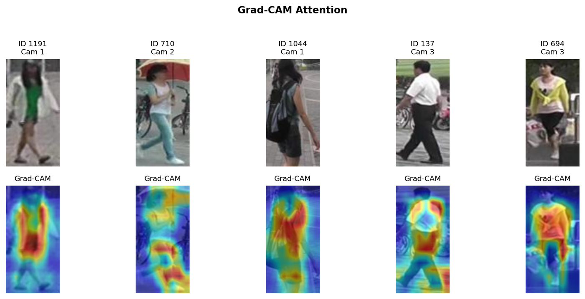
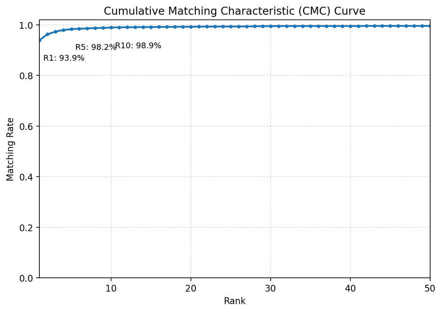

<div align="center">

# 🔍 Secondsight

### Cross-camera image retrieval with PyTorch and metric learning

Secondsight is an end-to-end **person re-identification research project** built with
ResNet-50, BNNeck, metric learning, and k-reciprocal re-ranking. Given a cropped
person image, it ranks candidates from another camera by embedding similarity.
It produces retrieval rankings, **not verified identity decisions**.

**Market-1501 · one published run (seed 42): 93.69% mAP / 94.95% Rank-1 with re-ranking.**
Without re-ranking: 84.78% mAP / 93.88% Rank-1. These are historical v0.2.0
release results, not a multi-seed or cross-dataset evaluation.

**[🔎 90-second project tour](docs/PROJECT_SHOWCASE.md)** &nbsp;·&nbsp;
**[📦 Trained model + run artifacts](https://github.com/vardhjain/Secondsight/releases/tag/v0.2.0)** &nbsp;·&nbsp;
**[📊 Results](#results)** &nbsp;·&nbsp;
**[▶ Run in Colab](https://colab.research.google.com/github/vardhjain/Secondsight/blob/main/notebooks/train_colab.ipynb)** &nbsp;·&nbsp;
**[🧠 Model card](docs/MODEL_CARD.md)**

[](https://github.com/vardhjain/Secondsight/actions/workflows/ci.yml)
[](https://www.python.org/downloads/)
[](LICENSE)
[](https://pytorch.org/)
[](https://github.com/astral-sh/ruff)

</div>

> [!NOTE]
> Person re-identification can be used for surveillance, so it deserves care. Please read the ethics
> and limitations section of the [model card](docs/MODEL_CARD.md) before using this work beyond
> research and benchmarking.

---

## What you can verify in this repo

| Evidence | Open it |
| --- | --- |
| **Working model artifact** | [v0.2.0 trained weights, config, history, and results](https://github.com/vardhjain/Secondsight/releases/tag/v0.2.0) |
| **Measured retrieval results** | [Recorded metrics JSON](https://github.com/vardhjain/Secondsight/releases/download/v0.2.0/results.json) and [full benchmark table](#results) |
| **Training and evaluation implementation** | [Training CLI](src/reid/cli/train.py), [evaluator](src/reid/evaluation/evaluator.py), and [tests](tests/) |
| **Engineering decisions and limits** | [Technical case study](docs/PROJECT_SHOWCASE.md) and [model card](docs/MODEL_CARD.md) |

The repository includes a local Gradio gallery demo and source code for a
deployable Hugging Face Space; **a public hosted demo has not been verified**.
The published images below are from the released research run.

<p align="center">
  
</p>
<p align="center"><em>Where the model looks. The heatmaps show that it relies on clothing and body shape, and largely ignores the background.</em></p>

## What this project is

Imagine a building with several security cameras that do not overlap. A person walks past one camera
and, a minute later, past another. The two pictures look quite different, because the angle, the
lighting, and the background have all changed. Person re-identification, usually shortened to Re-ID,
is the task of recognizing that both pictures show the same person.

Secondsight solves this by teaching a neural network to turn every photo into a short list of
numbers that acts like a fingerprint. Photos of the same person get similar fingerprints, and photos
of different people get different ones. Finding a person then becomes a simple search for the closest
fingerprints.

The project started as a single research notebook and was rebuilt into a complete, tested software
package. It trains the model, measures it honestly, explains its decisions with pictures, and serves
it through a small web demo.

## Results

The model was trained once on a Google Colab GPU (about 13 minutes on an A100, or roughly 40 minutes
on a free T4) and then tested on
Market-1501, a public benchmark with 3,368 search photos and 15,913 candidate photos.

| Setting         |  mAP   | Rank-1 | Rank-5 | Rank-10 | Reference (Luo et al., 2019)¹ |
| --------------- | :----: | :----: | :----: | :-----: | :---------------------------: |
| Standard search | 84.78% | 93.88% | 98.25% | 98.90%  |     ~85.9 mAP / ~94.5 R-1     |
| With re-ranking | 93.69% | 94.95% | 97.65% | 98.40%  |     ~94.2 mAP / ~95.4 R-1     |

¹ The reference figures were measured without flip test-time augmentation, so the comparison is
close but not strictly like for like.

**Rank-1** is the share of searches where the top result is the right person. **Rank-5** and
**Rank-10** count a search as a success when the right person appears anywhere in the first 5 or 10
results. **mAP**, short for mean average precision, is a stricter score that rewards the system for
placing every photo of the right person near the top, not only the first one. **Re-ranking** is an
optional second pass that reorders the results by checking whether two photos also appear in each
other's lists of closest matches.

The metrics above come from the **final-epoch checkpoint of a single v0.2.0 run**
(seed 42, 60 epochs), not a checkpoint selected using the test-set score. That
historical training run nevertheless **monitored the test set periodically**,
which creates a risk of experiment-level feedback. The current training code
no longer does so: it tests final weights only after training. The published
metrics have **not** been rerun under that updated workflow. The literature
reference is not a controlled apples-to-apples comparison because the recipes
and evaluation settings differ.

Re-ranking improves mAP and Rank-1 here, but **Rank-5 falls from 98.25% to
97.65% and Rank-10 from 98.90% to 98.40%**. Results are not averaged over
multiple seeds, and out-of-domain accuracy is not characterized.

For the exact v0.2.0 outputs, see the [results JSON](https://github.com/vardhjain/Secondsight/releases/download/v0.2.0/results.json),
[checkpoint](https://github.com/vardhjain/Secondsight/releases/download/v0.2.0/model_final.pth),
and [training history](https://github.com/vardhjain/Secondsight/releases/download/v0.2.0/history.json).

<p align="center">
  
  &nbsp;&nbsp;
  
</p>
<p align="center"><em>Left, three searches where the first answer was a lookalike and re-ranking corrected it. Right, how quickly the chance of finding the right person rises as more results are considered.</em></p>

## Engineering highlights

| What                           | Why it matters                                                                                                      |
| ------------------------------ | ------------------------------------------------------------------------------------------------------------------- |
| Installable Python package     | One install gives four commands that work from any folder, with the default settings shipped inside the package.     |
| 300+ automated tests           | The math of every loss and metric is checked against hand-computed values and a published reference implementation.  |
| Continuous integration         | Every change is linted, type-checked, tested on Python 3.10 to 3.14, built, and smoke-tested inside Docker.           |
| Honest evaluation              | Periodic checks use only held-out training identities; the test set is evaluated once after training.            |
| Typed, validated configuration | A typo in a settings file fails immediately with a clear message rather than an hour into training.                  |
| Explainability                 | Grad-CAM heatmaps and ranked-result galleries show what the model looks at and where it succeeds or fails.           |
| Reproducibility                | A locked dependency file, fixed random seeds, and a one-click Colab notebook reproduce the results end to end.        |
| Responsible release            | A model card documents intended use, limitations, and ethical considerations.                                        |

## Quick start

To inspect the work **without training or a GPU**, start with the
[90-second technical case study](docs/PROJECT_SHOWCASE.md), the
[re-ranked retrieval examples](docs/images/rerank_impact.png), and the
[released model, configuration and metric files](https://github.com/vardhjain/Secondsight/releases/tag/v0.2.0).
You can review the recorded results without downloading any dataset or weights.

For a full new training run, the Colab notebook installs the package, downloads
Market-1501 (subject to its access terms), trains, evaluates, renders the figures,
and packages the outputs as a zip file. GPU access and availability vary; the
model is **not** required just to inspect the showcase.

[](https://colab.research.google.com/github/vardhjain/Secondsight/blob/main/notebooks/train_colab.ipynb)

To run it on your own machine, install the package and use its four commands.

```bash
pip install -e ".[all,dev]"                        # or: uv sync --extra all --extra dev

reid-download                                      # fetches Market-1501 and prints its folder
export REID_DATA_ROOT=/path/printed/above

reid-train     --output-dir outputs                # trains and writes outputs/model_final.pth
reid-evaluate  --weights outputs/model_final.pth   # prints the results table
reid-visualize --weights outputs/model_final.pth --output figures
```

## How it works

1. **Learn a fingerprint for each photo.** A ResNet-50 network, a widely used image model that
   starts from general image knowledge, converts each person crop into 2,048 numbers called an
   embedding.
2. **Train with two complementary goals.** One goal asks the network to name the person in each
   training photo (a classification loss with label smoothing). The other pulls photos of the same
   person together and pushes different people apart (a triplet loss). The headline recipe adds a
   third goal, center loss, that keeps each person's photos tightly grouped.
3. **Build every training batch on purpose.** Each batch holds 16 people with 4 photos each, a scheme
   known as PK sampling, so the network always has same-person and different-person pairs to learn
   from.
4. **Separate the two goals cleanly.** A small normalization layer called BNNeck sits between the two
   training goals so they stop competing with each other, which is the key idea of the "strong
   baseline" this project follows.
5. **Search by distance.** At test time each photo and its mirror image are embedded and averaged,
   and candidates are ranked by how close their embeddings are to the query.
6. **Optionally re-rank.** A k-reciprocal re-ranking pass refines the list by favoring candidates that
   also consider the query one of their own nearest neighbors.

The recipe follows the ResNet-50 + BNNeck strong baseline from Luo et al. (*Bag of Tricks*, CVPRW
2019), and the re-ranking follows Zhong et al. (CVPR 2017).

<details>
<summary><b>Technical details of the recipe</b></summary>

<br>

The backbone keeps a higher-resolution feature map by using a stride of 1 in its final stage
(`last_stride=1`) and pools it with GeM (generalized-mean) pooling. Training uses Adam with a linear
learning-rate warmup followed by multistep decay, random cropping, horizontal flipping, and random
erasing. Automatic mixed precision keeps the run fast and light on memory, while every loss term is
still computed in full float32 precision for stability. At test time the features are L2-normalized,
so ranking by Euclidean distance gives the same order as ranking by cosine similarity.

The recipe differs from the paper in a few deliberate ways, stated here so the comparison stays
honest. It pools with GeM instead of global average pooling. It trains for 60 epochs with decay at
epochs 30 and 50, where the paper trains for 120 epochs with decay at 40 and 70. It evaluates with
horizontal-flip test-time augmentation, which the reference evaluator does not use. Re-ranking uses
the squared Euclidean distance, exactly like the Zhong et al. and Bag of Tricks reference
implementations. Evaluation keeps the standard Market-1501 rules, dropping junk images (identity
`-1`) while keeping the distractor crops (identity `0`) in the gallery. Average precision is the
non-interpolated form used by the reference code, which differs slightly from the trapezoidal variant
in the original MATLAB devkit.

</details>

## Installation

Secondsight supports Python 3.10 through 3.14. The core install is deliberately small and brings only
PyTorch, torchvision, NumPy, Pillow, PyYAML, and tqdm. Everything else lives in optional extras that
you add when you need them.

| Extra  | What it adds                                                      |
| ------ | ----------------------------------------------------------------- |
| `viz`  | Plotting and Grad-CAM (matplotlib, seaborn, scikit-learn, OpenCV) |
| `demo` | The Gradio web demo                                               |
| `data` | The Kaggle dataset downloader                                     |
| `all`  | The three extras above together                                   |
| `dev`  | Linting, type checking, and testing tools                         |

The quickest setup uses [`uv`](https://github.com/astral-sh/uv), which creates the environment and
installs everything in a single step.

```bash
uv sync --extra all --extra dev               # machines with a CUDA GPU
uv sync --extra all --extra dev --extra cpu   # CPU-only machines (installs the CPU PyTorch wheels)
```

`make install` runs the same `uv sync` for you, and plain `pip install -e ".[all,dev]"` works too. If
you call a feature whose extra is missing, the error message tells you exactly which one to install.

## Usage

Installing the package gives you four console commands, `reid-download`, `reid-train`,
`reid-evaluate`, and `reid-visualize`. They work from any directory, and each one accepts `--help`
for its full list of options.

The dataset location can be passed with `--data-root` or set once through the `REID_DATA_ROOT`
environment variable. It should point at the folder that holds `bounding_box_train/`, `query/`, and
`bounding_box_test/`. The `.env.example` file lists every variable the project understands.

When `--config` is omitted the commands use the headline recipe,
`market1501_strong_baseline.yaml`. Pass `--config configs/default.yaml` or your own YAML file to
change the recipe. The `Makefile` wraps the common workflows as well.

```bash
make train DATA_ROOT=/path/to/Market-1501-v15.09.15
make eval  DATA_ROOT=/path/to/Market-1501-v15.09.15 WEIGHTS=outputs/model_final.pth
make demo  DATA_ROOT=/path/to/Market-1501-v15.09.15 WEIGHTS=outputs/model_final.pth
```

## Configuration

Every setting lives in a typed configuration (`reid.config`) that loads from and saves to YAML. The
file `configs/default.yaml` mirrors the built-in defaults exactly, and it matches the headline recipe
in `configs/market1501_strong_baseline.yaml` except that center loss is switched off. Unknown keys
produce a warning instead of being silently ignored, and the configuration is validated after
command-line overrides are applied. Setting `device: auto` picks a CUDA GPU first, then Apple MPS,
then the CPU.

### Validation split and honest model selection

Market-1501 has no official validation set. Secondsight keeps the test set out of
training-time monitoring and checkpoint selection. With the default `data.val_ids: 0`,
there is **no periodic evaluation** and no `best.pth`; `last.pth`, `history.json`,
and `model_final.pth` are still written. To monitor validation mAP and select
`best.pth`, set `data.val_ids` to a positive number (or pass `--val-ids N`).
This holds out N training identities that have at least two images from each of
two cameras; it also reduces the identities available for training.

In both modes, **the final-epoch weights** (`model_final.pth`) are evaluated
on the test split only *after* training, and test metrics are saved to `results.json`.
The published v0.2.0 benchmark used the earlier periodic-test-monitoring
workflow (without selecting a checkpoint on test mAP); its metrics remain
historical single-run results until a new benchmark run is published.

## Demos

The repository includes two small web demos built with Gradio. The first, `app/gradio_app.py`, lets
you upload a photo and browse the closest matches from the Market-1501 gallery on your own machine.

```bash
python app/gradio_app.py --weights outputs/model_final.pth --data-root /path/to/Market-1501-v15.09.15
```

The second, in the [`space/`](space/) folder, is a lighter demo **ready to deploy**
to Hugging Face Spaces. A visitor can compare the embedding cosine similarity
of two consented or otherwise authorized person crops, without a same/different
identity verdict or arbitrary match threshold. The code runs on CPU and hosts
no gallery, but a live public deployment is not currently linked from this repo.
See [`space/DEPLOYING.md`](space/DEPLOYING.md) for setup.

The first demo also ships as a Docker image that is reachable from the host on port 7860.

```bash
make docker-build     # docker build -t secondsight .
make docker-run       # runs the Gradio demo on :7860, mounts ./outputs
```

## Project layout

```
src/reid/          # the importable library
  cli/             # train, evaluate, visualize and download command-line tools
  config.py        # typed, YAML-backed configuration
  data/            # Market-1501 dataset, validation split, PK sampler, transforms
  losses/          # triplet, label-smoothed cross-entropy, center, combined loss
  models/          # ResNet-50 backbone, GeM pooling, BNNeck model
  evaluation/      # CMC/mAP metrics, k-reciprocal re-ranking, evaluator
  engine/          # trainer and learning-rate schedulers
  utils/           # distance, checkpoint, logging, reproducibility helpers
  visualization/   # Grad-CAM, ranking galleries, analysis plots
scripts/           # thin wrappers that run the commands straight from a checkout
app/               # interactive Gradio demo
space/             # Hugging Face Space demo
configs/           # default.yaml and market1501_strong_baseline.yaml
notebooks/         # Colab training notebook and the original research notebook
docs/              # model card and figures
tests/             # pytest suite
```

## Development

The `Makefile` exposes the same quality checks that run in CI.

```bash
make lint          # ruff check .
make format        # ruff format . && ruff check --fix .
make typecheck     # mypy
make test          # pytest
make test-cov      # pytest with coverage
```

Dependabot updates the ordinary Python dependencies weekly. PyTorch and
torchvision use separate CPU and CUDA wheel sources and must be upgraded
together rather than through routine Dependabot version PRs. See
[`docs/DEPENDENCY_UPDATES.md`](docs/DEPENDENCY_UPDATES.md) for the manual
upgrade, validation, and security-update procedure.

Tests run on the CPU in a few minutes and never touch the network, since a shared fixture blocks
weight and dataset downloads. See [`CONTRIBUTING.md`](CONTRIBUTING.md) for the development setup and
conventions, and [`CHANGELOG.md`](CHANGELOG.md) for the history of changes.

## Model card, citation, and license

The [model card](docs/MODEL_CARD.md) documents the intended use, training data, evaluation protocol,
limitations, and ethical considerations. If you use this software, please cite it using the metadata
in [`CITATION.cff`](CITATION.cff). Secondsight is released under the MIT License, and the full text
is in [`LICENSE`](LICENSE).
