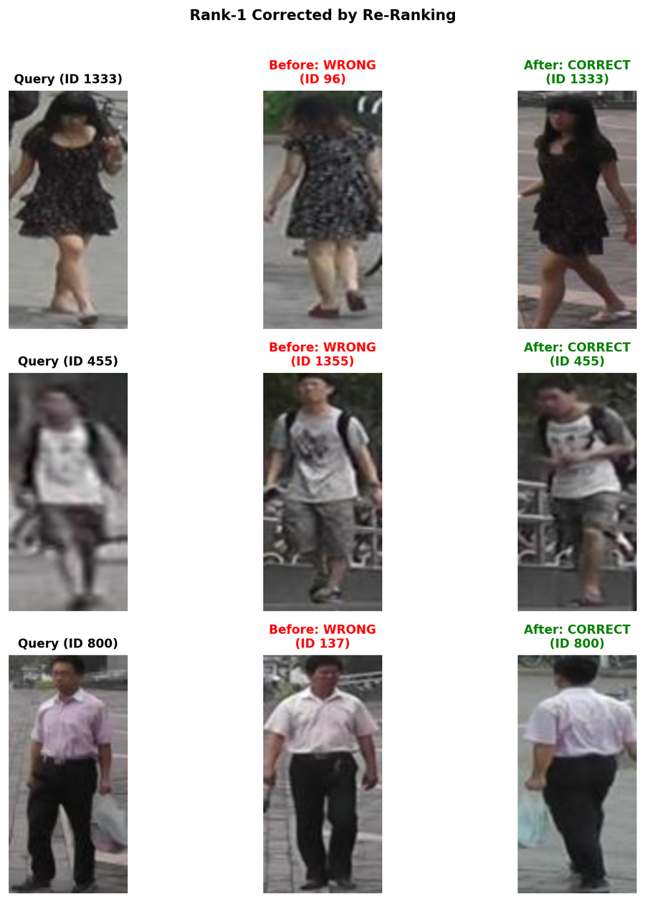

# Secondsight: ML engineering case study

**Task:** Cross-camera person re-identification as **image retrieval**, not
biometric identity verification. Given a cropped query photo, rank a gallery
of person crops by embedding similarity.

**Stack:** PyTorch, torchvision, ResNet-50, BNNeck, GeM pooling, triplet and
classification losses, k-reciprocal re-ranking, Gradio, pytest, Ruff, mypy,
GitHub Actions, Docker, and uv.

**Evidence:** [Repository](https://github.com/vardhjain/Secondsight) ·
[v0.2.0 release with actual weights](https://github.com/vardhjain/Secondsight/releases/tag/v0.2.0) ·
[raw results.json](https://github.com/vardhjain/Secondsight/releases/download/v0.2.0/results.json) ·
[model card](MODEL_CARD.md)

## The problem

Matching cropped person images across different cameras is hard because pose,
lighting, viewpoint, partial occlusion, and background change. A closed-gallery
re-identification benchmark asks a narrower, measurable question: **where do
known matching images rank among the gallery candidates?** It does not establish
that a person can be reliably identified in an unconstrained setting.

## What I built

I developed the project from a research notebook into an installable Python
package with:

- **Training:** an ImageNet-initialized ResNet-50 with stride adjustment and
  GeM pooling, a BNNeck embedding head, identity-balanced PK batches,
  label-smoothed cross-entropy and batch-hard triplet loss, with optional
  center loss. The published strong-baseline recipe uses center loss.
- **Retrieval:** L2-normalized embeddings, horizontal-flip test-time
  augmentation, Market-1501 cross-camera evaluation, and optional
  k-reciprocal re-ranking.
- **Engineering:** YAML configuration, CLI entry points, repeatable seeding,
  checkpoint and metrics artifacts, automated tests, a five-version Python
  CI matrix, type checks, Docker smoke testing, and a local Gradio interface.
- **Interpretability:** Grad-CAM heatmaps and ranked-result figures to inspect
  what the embedding model focuses on and which searches benefit from re-ranking.

The two demo variants serve different purposes: the
[local gallery-search demo](../app/gradio_app.py) illustrates ranking against
Market-1501, while the [deployable Space code](../space/app.py) demonstrates
pairwise embedding similarity. The latter intentionally does **not** label
unseen people as the same or different person using an uncalibrated threshold.
No verified public hosted Space is linked.

## The benchmark, without hiding the trade-offs

The **released v0.2.0** weights were trained for **60 epochs, seed 42** and
evaluated on Market-1501 (**3,368 query crops; 15,913 gallery crops**).

| Evaluation | mAP | Rank-1 | Rank-5 | Rank-10 |
| --- | ---: | ---: | ---: | ---: |
| Cosine retrieval + flip-TTA | 84.78% | 93.88% | 98.25% | 98.90% |
| + k-reciprocal re-ranking | 93.69% | 94.95% | 97.65% | 98.40% |

Re-ranking increases **mAP by 8.91 percentage points** and Rank-1 by
**1.07 points**, but lowers Rank-5 by 0.60 points and Rank-10 by 0.50 points.
It is an optional second pass, not a universal improvement across every metric.
The retrieval and re-ranking algorithm also have different runtime and memory
characteristics; **no throughput or memory benchmarks are claimed**.



*The image comes from the published v0.2.0 research run. Market-1501 crops are
not redistributed separately as demo images.*

## Decisions that matter to an ML engineering review

### 1. Validation is separate from benchmark testing

Market-1501 has no supplied validation partition. Current training code can
hold out suitable training identities (`--val-ids N`) and use them for periodic
evaluation and `best.pth` selection. Sparse identities are excluded unless
they retain cross-camera gallery positives for every validation query.

With the default `--val-ids 0`, no periodic evaluation or best-checkpoint
selection happens. The final-epoch `model_final.pth` is evaluated on the
benchmark test partition only after training.

**Historical caveat:** the v0.2.0 released run came from the earlier protocol
which *did* monitor the test split periodically, even though its headline
metrics used the final-epoch checkpoint rather than the best-scoring test
checkpoint. The released benchmark has not been retrained under the stricter
protocol. This is documented rather than concealed.

### 2. Treat model release as more than a single score

The [v0.2.0 release](https://github.com/vardhjain/Secondsight/releases/tag/v0.2.0)
includes the `model_final.pth` (~100 MB), `config.yaml`,
`results.json`, and `history.json`. You can inspect the model
configuration and observed metrics without running a GPU or downloading
Market-1501.

To independently evaluate the released weights, install the package, obtain
Market-1501 under its terms, download `model_final.pth` from the release,
and run:

```bash
reid-evaluate --weights /path/to/model_final.pth \
  --data-root /path/to/Market-1501-v15.09.15
```

The evaluation will still require the benchmark dataset and enough resources
for the chosen re-ranking settings; it is not a no-data demo.

### 3. Be explicit about known gaps

These results are from **one training seed and one dataset**. The
[reproducibility guide](REPRODUCIBILITY.md) documents the pinned notebook and
what a fresh run can and cannot reproduce. There is no measured
confidence interval, cross-dataset generalization evaluation,
calibrated pairwise identity classifier, production-service SLO, or measured
inference throughput. Re-ranking uses all-pairs relationships and can be
memory-intensive at scale. The [model card](MODEL_CARD.md) covers limitations,
dataset bias, and the risks of surveillance-related misuse.

## Code paths worth reviewing

| Question | Where |
| --- | --- |
| How are training/evaluation configured? | [Config](../src/reid/config.py) and [strong baseline YAML](../configs/market1501_strong_baseline.yaml) |
| How is training organized? | [Training CLI](../src/reid/cli/train.py), [trainer](../src/reid/engine/trainer.py) |
| How are valid identity holdouts made? | [Data builder](../src/reid/data/build.py), [split tests](../tests/test_build.py) |
| How are retrieval metrics produced? | [Evaluator](../src/reid/evaluation/evaluator.py), [re-ranking](../src/reid/evaluation/rerank.py) |
| What are the model and demo failure modes? | [Model card](MODEL_CARD.md), [Space demo tests](../tests/test_space.py) |
| Can this be built and exercised automatically? | [CI workflow](../.github/workflows/ci.yml), [Dockerfile](../Dockerfile) |

## Reproducible experiment tools and remaining evidence gaps

The [experiment harness](EXPERIMENTS.md) now generates seed-controlled YAML
ablation configurations and command manifests, plus a CPU-only synthetic
retrieval timing/memory-estimate report. CI tests these tools **without training
or downloading Market-1501**. A resumable executor prepares the remaining
runs on user-supplied compute, but no multi-seed Market-1501 training has yet
been executed. Their results are not a substitute for real
ablations: no new accuracy numbers, multi-seed variation, trained-model
inference throughput or observed peak RAM are claimed. Those require actual
executed experiments and should be added only with recorded provenance.

---

**Use boundary:** This is a research and engineering demonstration, not an
identity verification tool, public surveillance service, or justification for
tracking individuals. Use only authorized images, and do not redistribute
Market-1501 crops as public Space examples.
